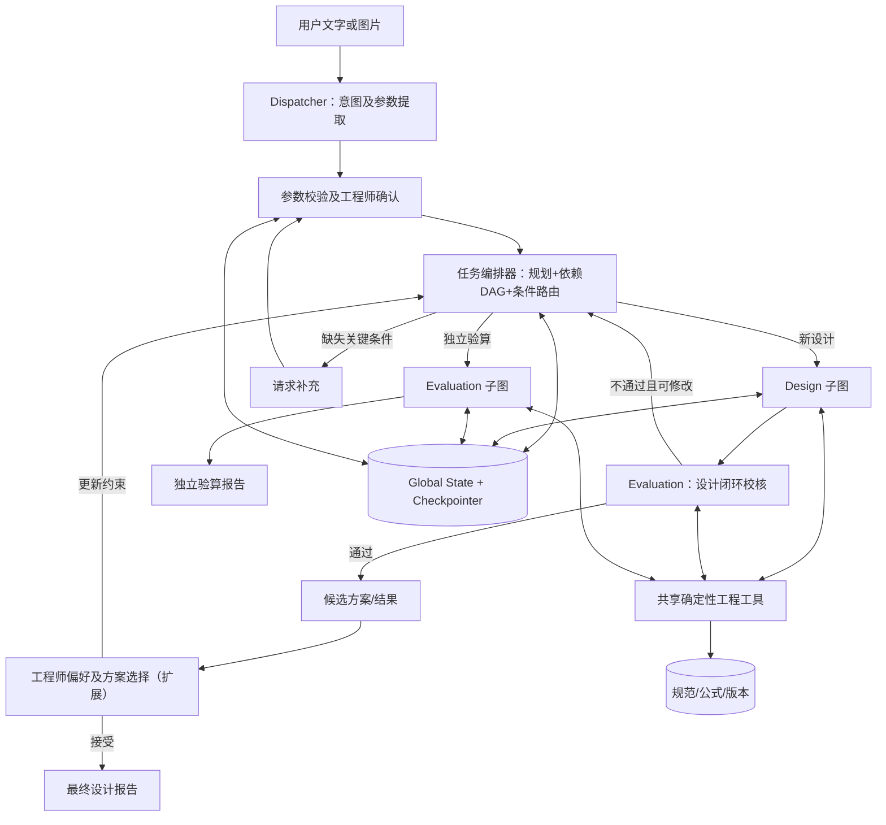
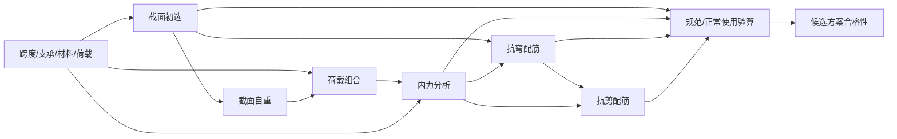

# EngiAgent 技术设计文档（V1.0）

**项目名称：** 基于 LangGraph 的状态驱动式人机协同结构设计多智能体系统  
**英文名称：** State-Driven Human–Agent Collaborative Framework for Structural Design Using LangGraph  
**工程示范对象：** 钢筋混凝土（RC）矩形梁，优先简支、常规静力荷载工况  
**文档定位：** 课程大作业立项—中期汇报—后续实现的共同设计基线  
**版本日期：** 2026-10-21  
**状态：** 设计方案；凡标注“规划”的功能均不表示已经编码完成

---

## 0. 阅读指南和设计结论

本文件不是论文综述，也不是逐文件源码说明，而是一份可以转换为开发任务的技术设计。先明确系统要做什么，再定义架构、信息流、工程算法、异常处理和验证方法。

**核心决策：**

1. **三个核心 Agent：** 任务分派器（Dispatcher）、结构设计（Design）、结构验算（Evaluation）。规范库、计算程序、DAG 编排器及人工审核均不是额外 Agent。
2. **两个业务入口：** 新方案设计与已有方案独立验算；在新方案设计流程中，Evaluation 还承担**独立校核关口**，校核失败可反馈给 Design 修改。
3. **三个特色机制：** （a）工程依赖 DAG 约束下的动态任务编排；（b）独立校核与可追溯计算；（c）工程师参与的输入确认和后续方案偏好选择。
4. **统一状态驱动：** Agent 间主要通过结构化 State 交换工程参数、工具结果和执行状态，而不是让 LLM 从聊天文字中反复推断数值。
5. **统一公制：** 输入可以用“m/mm、kN/N”等自然表达，程序内部按固定单位约定归一化；不用论文的英制单位。
6. **确定性计算：** LLM 负责理解、分派、规划建议和解释；公式计算、规范条件检查和 DAG 依赖由明确的程序规则处理。
7. **阶段策略：** 中期展示完整目标架构，但严格区分已实现、正在开发与规划扩展。首先交付可运行的最小闭环，再增加局部重算、OCR 与多方案偏好。

**一句话定位：** 以工程依赖关系约束 Agent 执行，以确定性工具和独立校核保证结果可复核，以工程师确认和方案偏好实现设计过程的人机协作。

## 1. 背景、问题与边界

### 1.1 项目问题

常规 RC 构件设计包含需求读取、参数确认、初步截面、荷载及内力、配筋、承载力和正常使用验算、必要的修改循环。传统工程程序可可靠地执行定义明确的计算，但不擅长处理不完整、口语化、反复修改的输入；LLM 擅长自然语言理解，却可能误读参数、捏造规范条文或算错公式。项目要结合二者的优势，而不是让 LLM 代替工程计算器或规范审查人员。

### 1.2 项目目标（G）

| 编号 | 目标 | 可验收的表现 |
|---|---|---|
| G1 | 自然语言任务识别与结构化提取 | 正确区分设计/验算/不支持；提取跨度、荷载、材料、截面、配筋及单位 |
| G2 | 参数缺失与工程约束处理 | 将字段分类为“用户必须确认/可由工具求取/允许有记录地默认”；不能偷偷补齐关键条件 |
| G3 | 状态驱动的动态执行 | 完整设计、局部验算、修改参数后三种请求能走不同路径 |
| G4 | 设计—验算闭环 | Design 产生候选方案，Evaluation 使用规范校核工具独立判定，不合格时报告原因并回到设计 |
| G5 | 工程数据可追溯 | 输入、来源、版本、公式/条文、工具结果、校核结论、错误状态可查询 |
| G6 | 人工确认与后续方案偏好 | 人工确认 OCR/提取参数；后续选择多个合规方案并施加净高/成本等约束 |
| G7 | 可视化交付 | Streamlit 显示输入参数、流程状态、计算摘要、规范引用与结果 |

### 1.3 当前范围与暂不开展

**MVP 范围：** 单跨、矩形、简支 RC 梁；给定恒载与活载等必要条件；截面初选、荷载组合、简化静力内力、受弯及受剪设计、至少一项正常使用校核；设计与既有梁验算两入口；中文交互与公制。实际算法范围以选定规范、可获得条文及实现测试为准。

**不在 MVP：** 多层框架完整建模、复杂抗震构造、施工图自动出图、完整 BIM/有限元软件联动、全面的规范知识问答、非线性分析、工程签章、生产级安全认证、LLM 参数微调。OCR 与多方案优化列入分期扩展；如果中期有余力，可提前实现最小 OCR 确认演示。

**工程用途声明：** 课程研究原型；输出仅用于教学与验证，不替代有资质工程师的正式设计审核。

### 1.4 技术环境和约束

既有项目工作区 `D:/code/EngiAgent`；conda 环境 `engiagent`（Python 3.11.16）；已接入 DeepSeek；以 LangGraph / LangChain 为编排基础，Streamlit 为首选界面；`pytest` 进行测试。此前项目已建立基础依赖和 Demo 骨架，不以本技术文档覆盖现有代码。未来版本应记录实际依赖锁定文件，确保重新安装一致。

## 2. 研究来源、继承与项目改造

### 2.1 主要参考论文

Chen, J., & Bao, Y. (2025). *Multi-agent large language model framework for code-compliant automated design of reinforced concrete structures*。

该文第 2 节包含 Dispatcher、Structure Design、Design Evaluation、Code-based Knowledge 和 Expert Consultation；第 3—4 节以 RC 梁展示设计与已有方案验算；第 5 节提供界面和执行状态反馈。论文将工程计算放在确定性工具中，并保存步骤结果供后续咨询。论文没有完整公布动态规划器的内部算法、Agent 间消息协议或 LangGraph 实现，因此本项目**不宣称复刻其未公开源代码**。

### 2.2 继承和调整对照

| 参考框架 | 本项目处理 | 设计原因 |
|---|---|---|
| Dispatcher 分类与参数抽取 | 保留并强化单位标准化、字段来源和人工确认 | 防止错误参数直接进入计算 |
| Design Agent 串接确定性工具 | 保留，加入正常使用验算及失败改设 | 完整设计不应在强度合格后提前结束 |
| Evaluation Agent 独立验算 | 保留，并兼顾设计闭环的校核关口 | 同一 Agent 服务两种真实需求 |
| Code-based Knowledge | 作为共享资源，不包装成 Agent | 规范知识与计算逻辑可测试、可复用 |
| Expert Consultation 三模型 | 中期不纳入核心 Agent 数量 | 缩小复杂度；后续可接入解释/修改服务 |
| Workflow Planning | 工程 DAG + 程序规则 + LLM 理解任务 | 明确规则边界，降低随意规划风险 |
| 人工交互 | OCR 参数确认 + 后续方案偏好 | 赋予工程师实际决策权 |

## 3. 总体架构和业务流程

### 3.1 分层说明

1. **交互层：** Streamlit、文字输入、图片上传、工程师确认、方案比较、报告下载。
2. **Agent 层：** Dispatcher、Design、Evaluation；三者负责不同推理职责，不直接承诺公式计算正确性。
3. **编排层：** 工程依赖 DAG、参数检查器、任务计划器、失效传播器、执行控制器及 LangGraph 条件边。
4. **工程能力层：** 规范知识模块、截面/荷载/内力/配筋/校核等确定性工具；工具接口和输入单位有统一约定。
5. **状态与持久化层：** 全局 State、Checkpoint、运行日志、历史方案与案例存储。

### 3.2 主图（目标架构）



**说明：** 该图是业务层逻辑，不要求每个方框都对应一个大模型节点；图中的 Evaluation 设计校核和独立验算是**同一个 Agent 的两种入口**，不是两个不同模型。

### 3.3 主流程的四种典型请求

- **P1 首次设计：** 用户提交梁设计需求 → 解析/确认 → 判断可设计性 → 设计工具串接 → Evaluation 校核 → 通过形成方案，失败返回原因并尝试有限次数的修改。
- **P2 独立验算：** 用户提供既有截面、配筋、材料与作用效应等 → 参数确认 → Evaluation 直接使用校核工具 → 独立验算报告；不必走 Design。
- **P3 部分条件：** 缺少梁高但已具备初选条件，可进入截面初选；缺失荷载工况、支承信息等关键前提，则提示补充或只返回明确标为“预估”的局部结果。
- **P4 局部修改：** “梁高从 500 改为 600 mm” → 提取变更 → 找出相关下游工具 → 标记旧结果失效 → 执行重算 → 再校核。不能沿用与修改参数关联的过期结果。

## 4. 核心 Agent 职责与接口

### 4.1 Dispatcher Agent

**输入：** 用户文本、图片解析文本、对话关联的当前方案、当前设计目标。  
**输出：** 结构化的 `TaskRequest`（意图、目标、目标构件、参数补丁、原始信息来源、置信提示、澄清事项）。

意图建议按操作层拆分，而不是只有论文的设计/验算二分：

- `new_design`：新设计；
- `evaluate_existing`：对已有方案独立验算；
- `modify_design`：修改已有方案；
- `explain_result`：仅解释既有结果（MVP 可标记待支持）；
- `unsupported`：非目标任务。

MVP 可在业务层将前四者路由为新设计、独立验算、状态变更/局部重算及不支持。**Dispatcher 不做结构设计，不直接推断未给出的荷载。**

建议使用 Pydantic 约束结构化输出，先检查字段再合并 State；不能把 LLM 返回的任意 JSON 直接传进工程工具。

### 4.2 Design Agent

**职责：** 在当前约束条件下生成候选设计；按照编排器允许的顺序调用初选、荷载、内力与配筋工具；按 Evaluation 返回的问题执行改设。

**输入：** 已确认的设计条件、可执行计划、当前版本。  
**输出：** 候选几何和配筋、工具调用记录、设计摘要、需校核事项。

建议内部子图：`precheck → section_sizing → load_combination → structural_analysis → flexural_design → shear_design → candidate_compose`，但这些步骤由规划器按条件选择；当某一步计算失败，不能跳过后仍认定设计完成。

正常使用验算应属于设计闭环的必须考虑环节；可以由 Evaluation 作为独立校核来执行，而不是让 Design 自称“全项合规”。

### 4.3 Evaluation Agent：双入口设计

**入口 A / 设计闭环校核：** 读取 Design 输出的候选截面、配筋、作用效应；按确定性校核流程检查抗弯、抗剪、构造和适用的正常使用指标；结果为 `pass/fail/incomplete/error`，附失败原因和允许的改设方向。失败反馈给 Design，经编排器重新安排相关任务。

**入口 B / 已有方案独立验算：** 接受用户直接提交的梁尺寸、配筋、材料和荷载/内力；独立完成需要的验算，不调用 Design 生成新方案；输出报告。

两个入口**共享核查工具，分别承担不同业务责任**。校核 Agent 可以独立组织验证，但若使用相同有缺陷的公式代码，不能宣称完全独立验证。关键算例应另用手算/公开例题/其他软件比较。

### 4.4 其他节点，不额外称作 Agent

- **参数确认节点：** 展示原始识别值、单位、来源和缺失项；工程师可编辑/批准/退回。
- **Task Orchestrator：** 接受结构化任务、生成可执行工具计划、维护依赖与版本；LLM 仅建议目标和参数变化，工程 DAG 决定硬性执行约束。
- **Tool Executor：** 按签名调用函数、验证返回值、记录执行状态。
- **Report Node：** 基于工具结果写解释和引用，禁止生成工具未计算的数据。
- **Preference Node（扩展）：** 工程师在多个合规方案中选择经济性、梁高、施工性等偏好；偏好转为显式约束再设计。

## 5. 统一工程数据和 Global State

### 5.1 关键原则

**固定“字段定义与单位”，不固定“字段取值”。** Dispatcher 每次生成动态参数补丁；工具依赖稳定的字段名。不要只用 Message 字符串传递跨度、钢筋面积或弯矩。

建议“输入参数”“推导参数”“候选设计”“验算结果”分开，避免旧结果覆盖用户原始条件。对来源标记为 `user`、`ocr`、`default_confirmed`、`tool`、`derived`，并记录单位和版本。

### 5.2 公制字段约定

| 类别 | 代表字段 | 内部约定 |
|---|---|---|
| 几何 | `span_mm`, `beam_width_mm`, `beam_depth_mm`, `cover_mm` | mm |
| 材料 | `concrete_grade`, `fc_mpa`, `fy_mpa` | 等级 + MPa |
| 作用 | `dead_load_kn_m`, `live_load_kn_m`, `Mu_kn_m`, `Vu_kn` | kN/m、kN·m、kN |
| 钢筋 | `bar_diameter_mm`, `bar_count`, `As_mm2`, `stirrup_spacing_mm` | mm、mm² |
| 响应 | `deflection_mm`, `deflection_limit_mm` | mm |
| 其他 | `support_type`, `code_id`, `load_case`, `exposure_class` | 受限枚举或经校验字符串 |

荷载需要明确是否包含梁自重；荷载种类及组合依据不能仅凭恒载、活载字样推定。规范默认值必须可见、可追溯并按规则确认。

### 5.3 数据模型草案

```python
from typing import TypedDict, Literal, NotRequired

class ParameterValue(TypedDict):
    value: float | int | str | None
    unit: str | None
    source: Literal['user','ocr','tool','derived','default_confirmed']
    confirmed: bool
    revision: int

class ToolResult(TypedDict):
    status: Literal['success','failed','blocked','skipped']
    inputs_hash: str
    inputs: dict
    outputs: dict
    code_refs: list[str]
    errors: list[str]
    revision: int

class EngineeringState(TypedDict):
    project_id: str
    case_id: str
    task_type: str
    user_query: str
    parameters: dict[str, ParameterValue]
    constraints: dict
    missing_parameters: list[str]
    pending_confirmations: list[str]
    design_revision: int
    execution_plan: list[str]
    tool_results: dict[str, ToolResult]
    tool_status: dict[str, str]
    invalidated_tools: list[str]
    candidate_designs: list[dict]
    evaluation_result: dict
    review_decision: NotRequired[str]
    report: NotRequired[str]
    errors: list[str]
```

这是概念数据模型，不是已可直接投入项目的完整类型定义。工程工具应通过 Pydantic 输入输出模型再进行强校验；量纲、有限数值、合法区间、条件组合、规范版本均需要独立校验。

### 5.4 State、Messages、Checkpointer 和案例库

- **State：** 一次或连续多次图执行中的结构化工作数据，节点直接读取，不让 LLM 重复从消息中解析数字。
- **Messages：** 保留语言交互、说明和必要的工具调用记录；不是计算结果的唯一来源。
- **Checkpointer：** 保存某一 `thread_id` 下的图状态，支持断点、人类确认后恢复与多轮继续；初期选 SQLite，后续可换服务端数据库。
- **案例库：** 仅将经过明确标记的候选/最终方案写为可检索的记录，包含 `case_id`, `design_revision`, `code_version`, `review_status`；不把所有 Checkpoint 默认等同于合格工程案例。

## 6. 动态任务编排：架构中的核心技术模块

### 6.1 “动态”的准确含义

**工程计算依赖一般是固定的；动态的是任务目标、输入完备程度、需要执行的工具子集，以及参数修改后的失效与重算。** 不能让 LLM 无约束地产生任意工程公式执行顺序，也不需要把每一种自然语言请求穷举为完整工作流。

### 6.2 模块构成

| 子模块 | 职责 | 谁保证正确性 |
|---|---|---|
| Intent/Delta Parser | 由 LLM 抽取任务及参数增量 | Schema 校验 + 人工确认 |
| Precondition Checker | 判断每个工具的输入是否已具备、已确认 | 程序规则 |
| Dependency DAG | 维护工具间输入/输出依赖 | 预定义工程规则 |
| Plan Builder | 取目标节点所需祖先节点，过滤有效缓存，生成拓扑序 | 程序规则；LLM 只建议任务目标 |
| Invalidation Engine | 根据变更字段找到受影响节点并将结果标记过期 | 程序规则 |
| Execution Controller | 遇到缺失、工具失败、校核失败时切换流程 | LangGraph 条件边 + 错误策略 |

### 6.3 工程 DAG（MVP 依赖定义）



这是流程层依赖草图。实际失效依赖必须细化为**字段级输入依赖**：例如梁高、宽度、自重标志、纵筋面积/位置、材料参数分别影响不同函数。否则会出现过度重算或漏算。即使某次荷载输入已包含自重，也必须检查自重是否应再次计算，防止双计。

### 6.4 规划算法（规则驱动）

输入：任务目标 `targets`，已确认参数 `P`，现有结果缓存 `C`，变更字段 `ΔP`。  
输出：`ready_steps`、`blocked_steps`、`missing_fields`、`invalidated_results`。

```text
1. LLM 解析用户意图和参数变更，形成 TaskRequest。
2. 合并参数前，对数值、量纲、来源和冲突执行校验；重大变化交工程师确认。
3. 根据任务类型指定最终目标节点（设计完成/抗弯验算/挠度验算等）。
4. 根据 DAG 回溯目标所需的前置计算；不相关工具不进计划。
5. 比较变更字段与各工具声明的 input_keys，使关联缓存失效。
6. 对所需工具按拓扑序排序；有效且版本匹配的结果可复用。
7. 执行前检测输入前提：
   - 可通过上游工具获得：先执行上游工具；
   - 必须由用户提供：暂停请求补充；
   - 允许默认：显示假设并要求按规则确认；
   - 缺乏关键条件：阻断最终合规结论。
8. 执行工具，记录结构化结果和错误；失败中止依赖它的下游工具。
9. Evaluation 校核，失败时生成不满足项及修正目标；受最大迭代次数约束重新规划。
```

### 6.5 四个必须演示的例子

**例 1：完整设计。** 输入跨度、荷载、混凝土、钢筋强度等 → 截面初选 → 荷载组合 → 内力 → 配筋 → 校核 → 报告。

**例 2：缺参数。** 输入“设计一根 6 m 简支梁” → 可识别跨度和支承方式，但材料、荷载等缺失 → 显示缺失清单、提出补充；仅允许标注为初步参考的局部结果，禁止宣称完成设计。

**例 3：独立局部验算。** 输入已知截面、钢筋和设计弯矩，只要求抗弯验算 → 直接选择 Evaluation 子图和相应核查工具，不执行初步截面设计与无关验算。若弯矩缺失，可根据已知作用条件安排内力计算或要求补充。

**例 4：局部修改。** 将梁高 500 → 600 mm → 触发自重、有效高度、相关承载力及变形等依赖检查；若自重变化影响设计荷载，内力亦重算。其他不相关且输入哈希未变化的计算结果可复用。

### 6.6 结果有效性和循环约束

- 每个工具结果保存输入哈希、设计版本、规范版本；缓存复用条件是这些依赖一致且结果此前成功。
- 修改输入后先标记旧结果 `stale`，不能在报告中引用过期结果。
- 校核失败后的自动修改应受 `max_design_iterations`（例如开发默认 3 次，可配置）控制；超过上限返回失败原因，不能无限自循环。
- “不满足规范”和“工具执行出错”是两种不同状态：前者可提示修改方案，后者应阻断合规结论并暴露诊断信息。
- 有多个候选设计时，必须区分草案、已校核、已人工确认和被驳回四种状态。

## 7. 工程计算工具与规范库

### 7.1 工具目录（设计优先级）

| 工具 | 作用 | 主要输入 | 主要输出 | MVP |
|---|---|---|---|---|
| `section_sizing` | 初步截面尺寸 | 跨度、支承、约束、规范 | 建议宽高 | 是 |
| `load_combination` | 按选定规范组合荷载 | 荷载种类、系数、几何、自重约定 | 作用组合及设计值 | 是 |
| `beam_analysis` | 简支梁内力计算 | 跨度、支承、荷载模型 | 弯矩、剪力 | 是 |
| `flexural_design` | 纵筋设计 | 弯矩、截面、材料 | 需求钢筋面积、配筋候选 | 是 |
| `shear_design` | 箍筋设计 | 剪力、截面、材料、纵筋 | 箍筋配置 | 是 |
| `flexural_check` | 已有配筋抗弯验算 | 实际钢筋和受力信息 | 比值/合格性 | 是 |
| `shear_check` | 抗剪验算 | 箍筋与剪力等 | 比值/合格性 | 是 |
| `serviceability_check` | 挠度及可选裂缝验算 | 截面、材料、钢筋、长期作用等 | 响应和限值比较 | 分阶段 |
| `detailing_check` | 构造检查 | 保护层、净距、间距、钢筋规格 | 合规清单 | 分阶段 |

**规范选择：** 拟以中国适用的混凝土设计标准为基础，需在实施前固定标准全称、版本、条文适用范围以及计算工具采用的公式来源。中国规范对正常使用极限状态、变形及裂缝等有明确要求，因此“设计合规”不能只看抗弯抗剪。若某项正常使用核查未实现，应在结果标明“未完成”，不可写“全面符合规范”。

### 7.2 工具接口契约

每个工具都应满足四条要求：

1. 输入参数明确且有单位、类型和合法区间校验。
2. 工程公式由确定性程序实现；LLM 不被要求自由进行高风险数值计算。
3. 输出结构化，含计算结果、判定条件、规范依据和必要的警告。
4. 中间与最终结果均有版本、输入哈希与执行状态，能够被复核。

示例返回结构：

```json
{
  "tool": "flexural_check",
  "status": "success",
  "inputs": {"Mu_kn_m": 180.0, "beam_width_mm": 300, "beam_depth_mm": 550},
  "outputs": {"demand_kn_m": 180.0, "capacity_kn_m": 210.0, "pass": true},
  "code_refs": ["应替换为实际采用规范的已核实条文编号"],
  "warnings": [],
  "revision": 2
}
```

此对象只展示字段关系，不暗示其中数值已按某一规范完成校核。**工具返回 `success` 代表计算执行成功，不等同于 `outputs.pass=true`。**

### 7.3 规范库的边界

规范库包含：标准的元数据/版本、已核实条文摘录或合法可用的摘要、公式及适用条件映射、工具与规范条文间的关联表。精确计算由程序完成，规范文本辅助检查与解释。缺少条文或适用条件时应如实标记，不由 LLM 编造条文编号。

## 8. Human-in-the-Loop：工程师参与机制

### 8.1 第一阶段：输入参数确认（优先实现）

典型流程：手写图片或文本 → OCR/LLM 识别 → 结构化参数表 → 单位与缺失检查 → `interrupt` 暂停 → 工程师更正或批准 → `Command(resume=...)` 恢复 → 执行 DAG 计划。

确认界面至少显示：原文/识别值、标准化值、单位、来源、未确定项和编辑控件。审核结果须保存在 State；未获确认的关键工程条件不得进入最终设计计算。若没有图像识别服务，MVP 可先对文字提取结果实施同样的确认机制，OCR 后加。

### 8.2 后续阶段：方案偏好与多方案协同

系统产生两个或更多**已完成必要校核**的候选方案，展示截面尺寸、配筋、预计材料指标、构造可行性、限制条件；工程师选择“梁高不得大于 500 mm”“优先减少钢筋”“优先施工便利”等偏好。系统将自然语言偏好转为可校验的约束，重新规划并求解，不能跳过规范校核。

这里不存在“人工偏好与截面初选矛盾”：截面初选是在约束集合内搜索设计变量。新的净高限制改变可行域；若无可行方案，系统返回约束冲突，不生成伪合规设计。成本/施工性指标缺少可靠量化数据时只能给出说明性比较，不宣称找到全局最优。

### 8.3 交互和持久化要求

暂停前确保必需 State 已持久化，同一 `thread_id` 用于恢复；确认节点的副作用（数据库写入、费用计算等）应避免重复执行，或设计为幂等。人工改动参数后必须触发校验与 DAG 失效传播。

## 9. 运行时状态机和异常处理

### 9.1 状态枚举

- 工具生命周期：`pending → running → success / failed / blocked / skipped`，变更后可转为 `stale`。
- 工程校核结论：`pass / fail / incomplete / error`。
- 人工审核：`awaiting_review / approved / revised / rejected`。
- 候选方案：`draft / checked / approved / rejected / superseded`。

### 9.2 异常和保护

| 情况 | 系统动作 | 禁止行为 |
|---|---|---|
| OCR 将 `6m` 识别为 `60m` | 展示来源、单位和异常提示，要求人工确认 | 未确认就进入计算 |
| 必要荷载缺失 | 挂起相应工具，提出具体补充问题 | 自动填入虚构荷载 |
| 截面工具失败 | 标记失败，阻止依赖结果继续执行 | 标记设计已完成 |
| 强度合格但挠度超限 | 返回明确不合格项，触发改设建议 | 输出“全面合规” |
| 修改参数后缓存过期 | 失效传播，按依赖重新计算 | 沿用旧结果形成新报告 |
| 无限方案迭代 | 限制次数，输出失败原因及需人工调整的约束 | 永久自动循环 |
| LLM 提出不支持的工具 | 校验白名单，拒绝调用并说明 | 任意执行模型生成代码 |
| 规范版本不匹配 | 阻断或注明不具可比性，待复核 | 混用不同标准的系数 |

## 10. LangGraph 映射方案

### 10.1 主图与子图

主图节点建议：`parse_request → normalize_parameters → human_confirm → plan_task → route`。路由后进入 `design_subgraph` 或 `evaluation_subgraph`，汇合到 `collect_results → generate_report → save_case`。

设计子图：`design_precheck → execute_design_plan → call_evaluation → revision_decision`，校核不通过可回到任务规划器；独立验算子图：`evaluation_precheck → execute_evaluation_plan → evaluation_report`。如需避免父图与子图跨状态键混乱，明确使用共享的父图字段和相应的输入/输出适配节点。

### 10.2 条件边示意

```python
# 仅展示路由思想，非完整可运行程序

def route_task(state):
    if state['pending_confirmations']:
        return 'human_confirm'
    if state['task_type'] in ('new_design', 'modify_design'):
        return 'design_subgraph'
    if state['task_type'] == 'evaluate_existing':
        return 'evaluation_subgraph'
    return 'unsupported'
```

实际代码需要处理：避免审核节点反复进入、修改状态后的再校验、设计迭代上限以及部分计算可执行/不可执行的分支。

### 10.3 Checkpointer 与人工恢复示意

```python
# LangGraph API 结构示意；按项目锁定版本核对导入路径
config = {"configurable": {"thread_id": case_thread_id}}
first = graph.invoke(initial_state, config)
# 执行在 human_confirm 内 interrupt(...) 暂停
resumed = graph.invoke(Command(resume=confirmed_payload), config)
```

开发期间可用持久化 SQLite Checkpointer；`thread_id` 指向同一任务的状态历史；跨项目工程案例依照单独的 `case_id` 管理。

## 11. 代码组织建议

保留现有 `D:/code/EngiAgent` 的可运行骨架，以渐进方式调整结构。建议目录如下：

```text
EngiAgent/
├── app.py                      # Streamlit 入口
├── run.py                      # CLI / Demo 入口
├── src/engiagent/
│   ├── graph/
│   │   ├── main_graph.py       # 主图和路由
│   │   ├── design_graph.py     # 设计子图
│   │   ├── evaluation_graph.py # 验算子图
│   │   └── state.py            # State 与类型
│   ├── agents/
│   │   ├── dispatcher.py
│   │   ├── design.py
│   │   └── evaluation.py
│   ├── orchestration/
│   │   ├── dependency_graph.py # 工程 DAG 定义
│   │   ├── preconditions.py    # 先决条件和缺失检查
│   │   ├── planner.py          # 子目标拓扑规划
│   │   └── invalidation.py     # 结果失效与重算
│   ├── engineering/
│   │   ├── schema.py           # 公制参数校验
│   │   ├── tools/              # 计算与校核工具
│   │   └── codes/              # 规范映射和适用条件
│   ├── hitl/
│   │   └── confirm.py
│   ├── persistence/
│   │   ├── checkpoint.py
│   │   └── case_repository.py
│   └── reporting/
│       └── reports.py
├── tests/
│   ├── unit/
│   ├── integration/
│   └── cases/
├── docs/
│   ├── architecture.md
│   └── references.md
└── README.md
```

**注意：** 此目录是建议目标，不要求立即移动已经写好的 `agent.py`、`run.py` 等文件。应先审查当前运行情况，再决定是否重构。

## 12. 测试、评价指标及验收

### 12.1 必备测试用例

| ID | 测试场景 | 核查重点 |
|---|---|---|
| T01 | 完整 RC 梁设计输入 | Dispatcher、参数归一化、完整工具链、设计报告 |
| T02 | 输入缺少荷载 | 正确阻断关键计算，展示缺失字段 |
| T03 | 未给梁高但已给足初选条件 | 由设计工具确定梁高而非擅自假设 |
| T04 | 已有梁仅验算抗弯 | 只执行所需的 Evaluation 计算 |
| T05 | 梁高变更 | 受影响节点重算，不相关缓存正确复用 |
| T06 | 故意设置挠度超限 | Evaluation 返回 `fail`，不能宣称全面合格 |
| T07 | OCR 关键数值识别错误 | 人工确认后再继续，使用更正的数字 |
| T08 | 工具异常/错误类型 | 传播失败，阻断依赖节点，报错可追溯 |
| T09 | 中途暂停并恢复 | 通过 `thread_id` 恢复已保存状态 |
| T10 | 校核无法通过 | 达到迭代上限后正确终止并列出限制因素 |

### 12.2 评价指标（先定义，再测量）

- **意图识别正确率：** 正确分类的请求数 / 总请求数。
- **参数提取准确率：** 按字段核对值、单位、来源；单独统计 OCR 误识别率。
- **数值误差：** 关键计算结果相对手算、规范例题或可靠软件的误差。
- **规范校核一致率：** 与人工参考判定一致的比例；按“通过/失败/不完整”分组。
- **动态规划有效性：** 任务目标覆盖率、无关工具跳过率、失效传播召回率、缓存误用次数。
- **执行效率：** 端到端耗时、LLM 调用次数、Token / API 开销、工具运行次数。
- **人工参与价值：** 有/无人工确认时关键输入错误传递到计算结果的比例。

优先保证“结果正确且不虚报合规”，再讨论效率提升。不预设本项目能复现论文所报告的特定准确率与节时比例。

### 12.3 对照实验设计

- **基线 A：** 固定全流程（每次都执行所有工具）。
- **方案 B：** 条件路由 + DAG 子目标计划 + 局部重算；相同计算工具、相同输入，对比正确性和冗余计算量。
- **输入确认对照：** 无人工确认的自动参数写入，与有人确认的流程对比关键错误发现率。
- **校核对照：** 仅输出 Design 结果与增加 Evaluation 校核关口，比较不合规结果是否被识别与拦截。

这些对照是课程项目更有说服力的证据，不要求规模庞大的统计研究，但应有可复现案例与完整日志。

## 13. 分阶段开发计划与中期汇报口径

### 阶段 0：已有基础核查（立即）

在 `engiagent` 环境中验证 DeepSeek 接入、LangGraph 基础图、工具调用与 CLI 启动；保存可运行的最小代码版本。以前已完成的骨架作为起点，不重复造轮子。

### 阶段 1：可运行 MVP（中期优先）

实现 Dispatcher 的结构化提取、Design 子图、Evaluation 的独立验算入口、少量可靠计算工具、共享 State、基本报告；至少跑通 T01、T02、T04。工况受限时明确写出适用范围。

### 阶段 2：核心差异化机制（中期展示重点）

实现规则 DAG、缺失字段检查、条件路由、参数变更后的失效与局部重算、设计校核失败返回；至少跑通 T03、T05、T06。相比多加一个 LLM Agent，这部分更能证明系统级设计能力。

### 阶段 3：HITL 和界面（中期可展示目标，后续完成）

使用 Streamlit 显示参数表与节点状态，添加确认/修改并在 LangGraph 中断后恢复。OCR 可先用模拟误识别案例或已有图像解析服务展示流程，但须注明是否实际接入模型；覆盖 T07、T09。

### 阶段 4：多方案设计与工程师偏好（结题扩展）

增加候选截面/配筋方案、可解释比较和偏好约束；更新方案后依赖重算、再校核；如难以量化成本，仅比较可核实的材料数量、梁高、配筋和施工约束。

### 中期汇报建议结构

1. **工程问题与动机：** 强规范约束、语言需求不完整、LLM 算术和事实可靠性问题。
2. **相关工作与借鉴：** Chen 和 Bao 的三业务 Agent 思路与确定性工具；说明本项目的改变。
3. **总体目标架构：** 三 Agent、两个验算入口、DAG、State、HITL、共享工具。
4. **关键技术设计：** 参数完整性、字段级依赖/失效、设计校核闭环、人工审核。
5. **运行 Demo：** 至少完整设计、局部验算、缺失参数反馈；条件允许展示梁高变更。
6. **结果和问题：** 已实现与规划严格区分，提出后续 OCR、偏好方案与更多规范校核的路线。

**项目特色表述模板：** “基于现有多智能体工程设计框架，提出一套状态驱动的任务执行与人机协同实现方案；通过工程依赖规则完成任务分派、局部重算和设计校核闭环，并预留工程师确认与方案偏好接口。” 课程汇报中不要把未完成能力说成已验证结果。

## 14. 关键风险与决策记录

| 风险 | 具体表现 | 缓解方案 |
|---|---|---|
| 规范公式过多 | 需要处理荷载组合、材料、构造、裂缝与长期挠度 | MVP 限缩梁类型，按工具逐项补足与验证 |
| LLM 结构化输出偏差 | 字段遗漏、单位混用、私自默认 | 强 Schema、来源记录、异常校验与人工确认 |
| 工程 DAG 漏依赖 | 梁高变化但某个相关结果没重算 | 字段级依赖声明、输入哈希和失效测试 |
| 设计/验算共同错误 | 两个 Agent 复用同一个错误公式 | 外部参考算例、单元测试、独立比对 |
| 工程师偏好无量化依据 | 把“最优”误当规范允许的唯一解 | 约束透明、候选方案比较，不强称全局最优 |
| Agent 循环和费用 | 校核失败不断重试、LLM 调用过多 | 迭代次数上限、规则编排优先、工具结果缓存 |
| 界面开发分散精力 | React / 前端工程挤占 Agent 学习 | MVP 首选 Streamlit；功能稳定后再考虑升级 |

### 暂定决策清单

- D1：三 Agent，不增加“规范 Agent”“人类审核 Agent”。
- D2：一个 Evaluation Agent，两种服务入口；设计中可复用其校核能力。
- D3：动态编排由 LLM 解析意图与程序 DAG 共同完成，不引入不受控的自由规划。
- D4：工程参数使用公制和强类型校验，保留来源、版本和失效状态。
- D5：State 用于节点间传递；SQLite Checkpointer 用于同一任务持续执行；正式案例另存。
- D6：首次 HITL 聚焦输入确认；偏好方案作为完整架构的一部分但后续实现。
- D7：中期完整展示目标架构，成果按“已实现/进行中/规划”明确标注。

## 15. 可以直接交给代码助手的首轮实现任务

> 在现有 `D:/code/EngiAgent` 项目中，先阅读 README、入口文件和已有 Agent/Graph 代码，不修改现有已能运行的 Demo。依据本技术设计文档：
>
> 1. 输出当前结构与目标架构的差异清单；
> 2. 先实现/校准工程输入 Schema 与 Global State；
> 3. 定义三个 Agent 的职责与两个业务入口；
> 4. 用确定性 Python 函数实现最小 RC 梁设计/校核工具，并给每个工具写单元测试；
> 5. 建立主图与设计、验算两个子图；
> 6. 再新增工程 DAG、参数缺失检查和失效重算；
> 7. 最后接 Streamlit 和人工确认。
>
> 代码应优先清晰、可调试和可验证；所有数值采用统一公制，不假设不存在的规范条文；对不可执行任务说明缺少什么条件。每完成一个子阶段给出可运行命令、样例输入、预期输出与测试结果，不要一次性生成庞大的未验证代码。

## 16. 参考来源与核验链接

**[R1]** Chen, J., & Bao, Y. (2025). *Multi-agent large language model framework for code-compliant automated design of reinforced concrete structures*. 用户提供 MinerU 转换文件。本文第 2 节为参考框架，第 3—5 节为功能案例；原论文中的实际编码机制未全部公开。

**[R2]** LangGraph 官方持久化文档：<https://langchain-ai.github.io/langgraph/concepts/durable_execution/> —— Checkpointer 与 Store 的用途和线程级状态管理。

**[R3]** LangGraph 官方中断/恢复说明：<https://github.com/langchain-ai/docs/blob/main/src/oss/langgraph/interrupts.mdx> —— `interrupt()`、`Command(resume=...)`、检查点和线程标识。

**[R4]** LangGraph `StateGraph.compile` 参考：<https://reference.langchain.com/python/langgraph/graph/state/StateGraph/compile> —— 使用 checkpointer 编译图。

**[R5]** 《混凝土结构设计标准》GB 50010—2010（2024 年版）第 3.4 节：<https://gf.cabr-fire.com/m/article-12587.htm> —— 正常使用极限状态、挠度等适用要求。实施时应使用可靠的正式规范文本核对具体条文和版本。

---

### 版本后续维护建议

- V1.0：项目目标、架构、接口、DAG、HITL、测试和路线确定。
- V1.1：根据现有代码实际情况，补上**节点—State 字段读写矩阵**和**工具输入输出 Schema**。
- V1.2：加入实际选定规范的公式与适用条件、通过测试的算例和 Streamlit 页面流程。
- 每次变更结构设计规则或工具公式时，同步更新测试案例与依赖关系，避免“代码已经改动，但技术文档仍是旧设计”。
