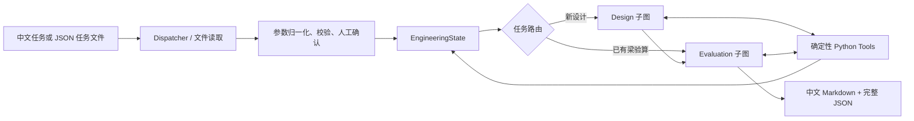

# EngiAgent 技术现状与规划对照

**更新日期：** 2026-10-22

**代码基线：** `main`，`ac9afa5`

**文档用途：** 中期汇报、开发交接与后续验收。本文以当前代码和测试为准；目标设计见 [EngiAgent_v1.0.md](EngiAgent_v1.0.md)，首轮工具依据见 [engineering_tools.md](engineering_tools.md)。

## 1. 一页读懂当前状态

EngiAgent 当前有两个入口：原有通用 Agent Demo，以及新增的 **RC 梁教学试算引擎**。工程引擎已能通过中文命令行接收自然语言或结构化任务，确认参数后，完成简支矩形梁的**新方案设计**或**已有梁独立验算**，并输出中文 Markdown 报告与完整 JSON 记录。

当前最准确的成果表述是：

> 已建立“任务解析 → 参数确认 → 确定性工程计算 → 方案校核 → 可追溯报告”的 RC 梁最小运行闭环；中国规范适配、工程依赖 DAG 局部重算和自动改设仍属后续工作。

本轮计算模型名为 `teaching-rc-1`。它参考公开 RC 梁算例中的部分公式与工作顺序，**不是中国规范实现，也不是完整 ACI 规范实现**。所请求分项可以显示“教学试算通过”，但 JSON 中 `code_status` 固定为“未完成”，`overall_status` 固定为 `incomplete`。这些状态分别回答“已实现检查是否通过”与“是否达到完整工程合规”，不能混用。

## 2. 最初规划与首轮实施范围

### 2.1 V1.0 目标架构

最初的 [V1.0 设计文档](EngiAgent_v1.0.md)提出三名核心角色：`Dispatcher` 负责需求识别和参数提取，`Design` 负责组织设计，`Evaluation` 负责已有方案验算并承担设计后的校核关口。共享的规范知识与 Python 计算工具不单独算作 Agent。两个业务入口分别是新方案设计和已有方案独立验算。

目标架构还包括：由工程依赖 DAG 控制任务顺序和参数变更后的局部重算；利用统一 `State` 传递参数、方案和结果；通过 LangGraph Checkpointer 支持人工审核后的跨进程恢复；逐步加入中国规范映射、Streamlit、OCR、多方案及工程师偏好选择。这些是项目目标，不等于当前已有能力。

### 2.2 首轮核心引擎的收敛决策

首轮实施计划把工程对象限定为**单跨、简支、矩形 RC 梁，单层受拉纵筋，全跨均布恒载和活载**。先实现参数确认、截面/荷载/内力/配筋计算、受弯受剪校核以及毛截面弹性挠度试算。计算与离散配筋选择由 Python 工具完成；LLM 负责参数提取及受白名单约束的工具顺序确认。遇到截面不适用、布置失败或校核不通过，记录原因并结束本轮，不自动增大截面或循环改设。

这一收敛解释了目前代码与 V1.0 长期目标的差异：**首轮先交付可验证的工程计算闭环，动态 DAG、完整规范与可视化界面后续开发。**

## 3. 当前软件架构



| 层次 | 当前实现 | 主要文件 |
|---|---|---|
| 入口与交互 | `run.py --engineering`；中文确认表、修改命令、进度与摘要 | `run.py`、`engineering/cli.py`、`engineering/presentation.py` |
| LLM 角色 | 同一 DeepSeek 模型上的三个独立角色；结构化输出 | `engineering/roles.py` |
| 编排 | LangGraph 主图；Design、Evaluation 两个子图；设计任务完成后进入 Evaluation | `engineering/workflow.py` |
| 工程数据 | Pydantic 参数、配置、工具结果、进度与验算状态 | `engineering/schema.py`、`engineering/outputs.py` |
| 计算工具 | 按固定白名单执行的 Python 函数 | `engineering/tools.py` |
| 结果交付 | 中文 Markdown 报告与完整精度 JSON | `engineering/reporting.py` |

这里的“独立验算”指 **Evaluation 不直接采纳 Design 给出的承载力或通过结论，而是用实际截面和实配钢筋重新计算**。设计与验算仍共享部分底层公式代码，因此需要独立手算与外部算例来验证工具本身。

### 3.1 输入与状态契约

- `TaskRequest` 表示任务类型、参数、请求验算项目与澄清信息。当前任务类型为 `new_design`、`evaluate_existing`、`unsupported`。
- `ParameterValue` 保留原值、原单位、标准化值、来源、确认状态和修订号。内部采用 mm、MPa、kN、kN·m 等固定单位。
- `TeachingProfile` 保存本次采用的荷载系数、材料模型与试算系数；确认表一并展示这些假设。
- `EngineeringState` 保存请求、候选方案、工具轨迹、角色事件、进度事件、错误和分项结论。确认时对任务与配置生成哈希；确认后变更输入会拒绝计算。
- `ToolResult` 保存工具输入、输出、执行状态、公式版本、依据、警告、错误与输入哈希。当前哈希用于追溯，**尚未用于缓存复用或 DAG 失效传播**。

### 3.2 三个角色实际做什么

| 角色 | 当前职责 | 程序约束 |
|---|---|---|
| Dispatcher | 将自然语言提取成结构化任务和参数；缺失项交给确认流程 | 不计算、不能凭空补荷载与材料条件；Schema 校验后才进入工程流程 |
| Design | 对新方案返回工程工具计划 | 计划必须与固定 `required_steps` 顺序一致；工具由程序调用 |
| Evaluation | 对候选或已有梁返回校核工具计划 | 实配方案重新计算；所请求项目由程序汇总判定 |

结构化文件可直接跳过 Dispatcher 的模型请求。`--offline` 使用明确标注的 `FixtureRoles` 固定测试角色，不提供离线自然语言解析。真实模型运行使用 `DeepSeekRoles`；模型接口失败、格式不合规或计划违反白名单时，流程返回错误，不产生通过结论。

## 4. 工程计算链与适用范围

设计工具按以下顺序执行：

1. `section_sizing`：保留已给截面，或按教学规则初选尺寸。
2. `section_geometry`：计算有效高度、钢筋几何与毛截面惯性矩。
3. `load_combination`：按自重约定求恒载、自重、承载力试算荷载与使用荷载。
4. `beam_analysis`：求全跨均布荷载下的支座反力、弯矩和剪力。
5. `flexural_design`：计算所需钢筋面积，选择整数根数并检查实配容量与单层布置。
6. `shear_design`：根据实际有效高度和临界截面剪力求箍筋间距。

Evaluation 重新执行前四个共同步骤，再按目标选择 `flexural_check`、`detailing_check`、`shear_check`、`elastic_deflection`。已有梁可只请求抗弯检查；无关的抗剪、挠度步骤不会运行。挠度目前使用正常使用荷载、毛截面惯性矩和给定弹性模量作**简化弹性挠度**计算。

具体公式、单位边界、控制条件及参考算例见 [工程工具计算说明](engineering_tools.md)。本轮不包括开裂刚度、长期挠度、裂缝、锚固搭接、耐久性、抗震构造及完整构造要求。论文参数可作教学对照；`fc_mpa` 表示当前参考模型中的混凝土圆柱抗压强度，不能直接等同中国材料等级或中国规范设计强度。

## 5. 原规划与完成程度

状态使用 **已完成 / 部分完成 / 未开始**，不以主观百分比代替可验收事实。

| V1.0 规划项 | 当前状态 | 当前证据与剩余工作 |
|---|---|---|
| 保留原 Demo 与环境基线 | **已完成** | `run.py` 保留原入口与 `EngiAgent.run_turn()`；原测试继续通过。 |
| 自然语言任务识别、参数提取 | **已完成（限定工况）** | 真实 DeepSeek Dispatcher 可输出 `TaskRequest`；仅支持规定的 RC 梁任务；缺项和不支持工况可阻断。 |
| 原值/单位/来源记录与人工参数确认 | **已完成（当前进程）** | 中文确认表可修改或补充参数，确认哈希保护输入。尚无 LangGraph `interrupt` 与跨进程恢复。 |
| 新方案设计与已有方案独立验算 | **已完成（教学模型）** | 主图双入口、Design/Evaluation 子图与确定性工具链已运行。设计校核不通过后停止并报告原因。 |
| 条件路由与只运行相关工具 | **部分完成** | 可按设计/验算任务路由，已有梁可只验抗弯；工具顺序仍由固定规则列表指定。 |
| 工程依赖 DAG、参数变更失效与局部重算 | **未开始** | 当前 `ToolResult.inputs_hash` 只作追溯；已运行状态不能在原状态上重算，修改参数需重新准备任务。 |
| 设计校核失败后的自动改设循环 | **未开始** | 当前只报告失败，不自动调整截面、配筋或重试。 |
| 公式/规范/工具映射 | **部分完成** | `teaching-rc-1` 有公式版本、工具说明和参考算例；中国规范条文映射与逐项核验未完成。 |
| 中国规范适配与完整构造/正常使用检查 | **未开始** | 目前始终标记中国规范核验“未完成”；只实现有限教学检查。 |
| 工程师可读的参数、步骤与报告 | **已完成（CLI）** | 中文确认表、实时进度、方案与验算对比、Markdown/JSON 已完成。 |
| SQLite Checkpointer、持久化恢复 | **未开始** | 当前 JSON 为一次运行结果导出，不是可恢复图状态。 |
| Streamlit 界面与 OCR | **未开始** | 当前是 CLI，输入为文本或 JSON；没有图片参数识别。 |
| 多候选方案及工程师偏好选择 | **未开始** | 当前新设计只形成一个候选方案。 |
| 系统化评价与对照实验 | **部分完成** | 有离线回归、独立手算对照和少量真实模型冒烟验证；尚未建立批量提取准确率、DAG 重算收益等研究指标。 |

按 [V1.0 的阶段计划](EngiAgent_v1.0.md)，**阶段 0 和阶段 1 的首轮受限 MVP 已完成**；阶段 2 的缺项检查、任务路由和失败判定已部分实现，DAG 局部重算与自动改设尚缺；阶段 3 只完成 CLI 人工确认，Streamlit/OCR/中断恢复尚缺；阶段 4 尚未开始。

### 5.1 原计划测试用例对照

| 用例 | 现状 |
|---|---|
| T01 完整设计、T02 缺少荷载、T03 未给梁高初选、T04 仅抗弯验算 | **已覆盖**；T03 只验证初选与是否可行，不包含后续动态改设。 |
| T05 梁高变更后局部重算与缓存复用 | **未实现**。 |
| T06 挠度超限、T08 工具异常传播 | **已覆盖**。 |
| T07 OCR 数值识别错误 | **未实现 OCR**；文字提取后的人工更正已有覆盖。 |
| T09 中途暂停并恢复 | **未实现**。 |
| T10 校核失败后迭代并在上限终止 | **未实现迭代**；当前直接报告失败并终止。 |

## 6. 运行、验证与结果解释

在项目根目录执行，示例 Python 路径对应当前开发环境：

```powershell
# 整数公制参数，新梁设计；屏幕确认参数后开始计算
& D:\anaconda\envs\engiagent\python.exe run.py --engineering --request examples/engineering/metric_design.json --offline

# 已有梁完整验算
& D:\anaconda\envs\engiagent\python.exe run.py --engineering --request examples/engineering/metric_existing.json --offline

# 已有梁仅验抗弯；参考案例预期返回不通过
& D:\anaconda\envs\engiagent\python.exe run.py --engineering --request examples/engineering/flexure_only.json --offline --approve

# 使用真实 DeepSeek，传入完整自然语言任务
& D:\anaconda\envs\engiagent\python.exe run.py --engineering --query "请设计一根简支矩形 RC 梁，跨度 6 m，……"

# 当前离线测试入口
& D:\anaconda\envs\engiagent\python.exe scripts/run_tests.py
```

真实模型运行需要本机已配置的 DeepSeek API 凭证。`--query` 的省略号仅表示示意，实际输入必须给足材料、荷载、自重约定、钢筋和教学限值等关键条件。可参考 [metric_design.json](../examples/engineering/metric_design.json) 组织参数；完整命令说明见 [README](../README.md)。

运行结果写入默认 `outputs/`：Markdown 面向工程师阅读，JSON 保留完整精度及工具输入输出。终端会显示参数确认、实时进度、方案和分项验算摘要。退出码 `0` 表示**所请求教学检查通过**；`2` 表示试算失败、不完整或执行错误。工具的 `status=success` 只表示函数成功返回，`outputs.pass` 才是该分项判定。两者均不能替代完整规范审查。

**验证记录：** 2026-10-22 在当前工作区执行 `scripts/run_tests.py`，结果 **74 passed**。此前已用真实 DeepSeek 验证自然语言新设计的三个角色调用，以及已有梁仅抗弯的 Evaluation 入口；本次文档更新没有重新发起付费 API 请求。测试覆盖新设计、已有梁验算、单位混用、缺项、确认后修改、工程失败、模型和工具错误、报告显示及原 Demo 回归。

## 7. 后续实施顺序与中期汇报口径

1. **规范基线与工程工具扩展。** 固定适用的中国标准版本、材料与荷载定义，建立“条文—公式—适用条件—工具—基准算例”映射；逐项补齐构造、正常使用与限值检查。完成核验后，再改变“中国规范未完成”的状态规则。
2. **工程依赖 DAG。** 将每个工具的输入依赖显式声明，先实现单参数修改后的失效识别与局部重算，再加入缓存复用和变更测试；重点验证梁高、自重、有效高度及挠度相关链路。
3. **设计校核闭环。** 明确有限次改设策略和终止条件，让 Evaluation 的失败原因驱动重新选择截面或配筋，并保留每轮方案与校核记录。
4. **持久化与界面。** 增加 Checkpointer、LangGraph `interrupt/resume`、Streamlit 参数确认与结果可视化；再接 OCR，使图片提取结果进入同一确认流程。
5. **多方案与研究评价。** 生成可比较的候选方案，加入工程师偏好约束；在相同算例和工具下对比固定全流程与 DAG 局部重算的工具调用量、耗时及结果一致性。

中期汇报中，技术路线图可展示**完整目标架构**，但展示进展时应明确标注：当前已完成的是 **CLI 中的双入口教学试算与可追溯报告**；DAG 局部重算、中国规范适配、自动改设、Streamlit、OCR 与多方案仍是规划。这一口径与代码实际状态一致。

## 8. 参考文档

- [EngiAgent V1.0 技术设计文档](EngiAgent_v1.0.md)：目标架构、分阶段计划和原始验收用例。
- [首轮工程工具计算说明](engineering_tools.md)：`teaching-rc-1` 的公式、单位、来源和适用边界。
- [首轮核心引擎操作与验收](engineering_acceptance.md)：实施阶段、参考案例与早期验证记录。
- [项目 README](../README.md)：当前运行命令与示例。
