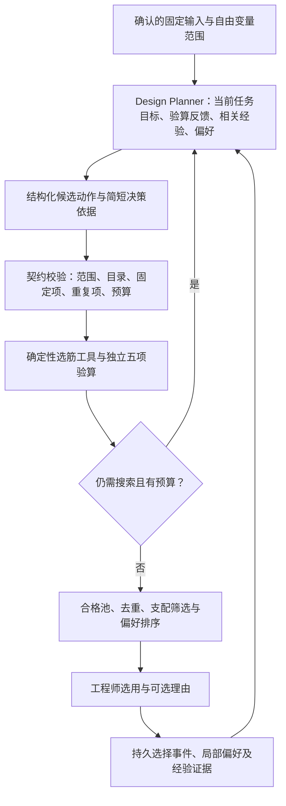

# Design Agent 自主规划与工程师偏好学习：改造提案

日期：2026-11-03。状态：基于当前代码审查的设计提案，以下新增接口和学习能力尚未实现。

## 当前代码事实

- `engineering/roles.py` 的 `RolePlan` 只返回工具名列表及解释；`DeepSeekRoles.plan` 要求原样返回 `required_steps`。`cn_workflow.invoke_role` 再校验列表完全相等。这是受约束的流程组织，不是模型自主规划优化路径。
- `engineering/design_search.py` 的 `CandidateSearch.propose` 用固定优先级队列生成截面/配筋候选。参数使用离散网格，但不是穷举网格搜索。许可直径分支可能先用完小预算。
- `ui/service.py` 的 `select_design_alternative` 保存 `EngineerSelection` 审计事件，没有训练排序模型，也没有持久偏好档案。新任务加载会重置会话调用记录，不能据此宣称跨任务学习。
- 数值工具、独立验算、确认哈希、缓存与全部尝试记录可继续复用，不需要为了增加 Agent 能力而重写公式。

## 改造目标

让模型有权决定“在剩余预算里，下一步比较哪些合法设计、为什么比较、何时结束”，同时学习工程师在合格方案之间的取舍。模型不能修改确认的固定输入、规范规则或验算结论。

应分别报告三种能力：

1. 单任务反馈规划：使用本轮真实工具结果调整下一步，不等于跨任务学习。
2. 跨任务经验与偏好适应：检索可追溯案例、更新工程师偏好排序；基础大模型权重可以保持不变。
3. 大模型权重训练：需要可训练模型、偏好数据及独立训练评估管线，不是多调用几次普通推理API即可获得。

## 建议运行循环

这张图中的经验反馈用于后续决策；工程师选用后不自动触发新一轮计算。

## 模块与接口建议

|模块|建议职责|
|---|---|
|`design_planner.py`（新增）|定义 `DesignDecision`、真实模型适配器、离线测试适配器、候选动作和输入上下文|
|`cn_workflow.py`|每批验算后请求规划决策；执行经校验候选；保留现有数值DAG及独立验算|
|`design_search.py`|保留合法离散域、去重、规则基线和显式备用策略；增加搜索预算分配；将偏好排序与可行性筛选分开|
|`preference_store.py`（新增）|本地SQLite持久化任务、选择事件、画像版本、冻结的训练/评估快照|
|`preference_model.py`（新增）|先做可解释显式偏好；数据累积后可采用带正则的成对偏好模型|
|`experience_memory.py`（新增）|按任务边界、荷载、几何、材料和公式版本检索已验证案例；提供证据，不把经验当规范|
|`ui/service.py`|在选用事件中保存实际展示的候选集合、原推荐、最终选用、选择理由、任务上下文和画像作用域|
|界面与报告|展示真实规划动作、采用的经验和偏好、预算及动作来源；允许查看/重置偏好|

这些是拟新增职责和文件名，不是当前已经存在的功能。

### Planner 输出

`DesignDecision` 建议包括：`action`（propose/stop）、1—3个有目的的候选、简短策略依据、引用的工具结果ID、相关经验ID、所用偏好版本、预期权衡及停止原因。

候选仅允许给出自由的梁宽、梁高、许可纵筋直径、纵筋最小根数；实际配筋与配箍继续由工具设计。能够指定两个或更多自由变量的组合，避免每次机械只改一个变量。不得填入手算承载力、伪造通过结论、可执行代码或未授权字段。

示例决策：在跨度、荷载和材料不变的前提下，同时比较一个较低梁高方案和一个增高后少配筋方案；引用当前挠度/裂缝结果作为决策依据，而不是按直径列表逐个耗尽预算。

Planner 输入应含当前确认契约、已测试候选及失败原因、通过池、余量/利用率、剩余预算、相关案例及当前任务偏好。无需反复发送全部长计算书或所有历史对话。

### 预算与执行

- 区分模型决策次数、完整候选验算次数、工具实际执行/缓存复用次数和总时限；不能靠把所有比较藏进一轮制造效率提升。
- 六个候选的短预算也应允许截面与配筋联合探索，例如先规划少量有取舍的组合，再依据反馈分配剩余预算。探索配额可以防止只改直径，具体比例应通过实验选择。
- 参数仍可离散到工程允许网格，模型自主选择网格上的候选，与模型自主规划并不矛盾。
- 越界、重复及固定项变更由程序拒绝并反馈。模型重试有独立小上限。模型不可用时停止或使用明确标记的规则备用策略，审计必须区分来源。
- 候选生成和合格方案的排序是不同职责；不能只加一个模型解释步骤，就声称实现了自主规划。

## 偏好学习

### 应记录的证据

每次明确选用都保存：工程师/项目作用域、任务边界、实际展示过的合格候选、界面推荐、选择结果、可选理由、候选特征、公式及模型版本、时间、画像版本。默认推荐被动保留和主动改选应分开；选中一个候选不等于明确拒绝所有未展示方案。

可选理由如“优先净高”“偏好较大正常使用裕量”“常用直径统一”“较少受拉纵筋”“项目供应限制”“仅本次选择”。理由不是强制填写，也不应每次弹窗打断工作。

单次选择具有多种解释。例如3Φ22优于3Φ20可能来自裕量偏好，也可能来自库存或项目统一要求；不能直接把它写成工程师长期偏好。显式声明的当前任务要求优先于历史推断，项目偏好与个人长期偏好分开。

### 实现顺序

1. 先实现持久事件、显式偏好和画像展示；偏好数据不足时保留默认推荐并标明证据不足。
2. 引入相似任务检索。经验必须关联真实输入、工具结果和适用范围；LLM总结是待验证解释，不能自动升级为通用工程规律。
3. 累积可比较选择后，再训练轻量成对排序模型，例如带正则的Bradley–Terry/logistic模型；只在合格候选之间更新排名，并记录版本和不确定性。少量记录不能支撑稳定偏好结论。
4. 对候选生成也提供画像：若当前任务重视净高，Planner优先探索较低梁高的合法组合；如果只改变最终排名，不能声称提高了搜索效率。
5. 画像可查看、修正、停用或重置；跨工程师不默认共享推断偏好。跨进程恢复后应能复现一次推荐用了什么数据与版本。

偏好不能改变规范和确认的硬约束，也不能把只考虑下部纵筋面积的指标称为总造价。若要学习经济取舍，还需提供可信的全量钢筋、模板、单价等特征，或者明确当前只是局部材料代理指标。

Pareto初筛也应使用本任务实际启用的目标。如果工程师重视常用直径统一，应把可追溯的规格统一指标纳入比较，或为该偏好保留代表项；不能先按原四指标删掉全部相关候选，再声称学习后的排序尊重了该偏好。未标注的软偏好也不能升级为禁止其他合法直径的硬约束。

## 对“持续学习”的研究表述

- 本轮成功/失败反馈帮助下轮规划：单任务反馈适应。
- 带适用条件检索过去的真实失败与成功：基于经验记忆的跨任务适应。
- 从真实工程师成对选择更新小型排序器：系统层面的偏好学习。
- 将已有偏好/案例放入大模型上下文：基础大模型权重未变。
- DPO等方法训练可训练模型：才涉及大模型参数更新，仍需工程任务上的独立验证。

不能仅因为系统记录了对话、生成了“反思”文字，便声称已经学会工程设计。

## 验证设计

建议以相同CN工具、相同自由变量及候选验算预算比较：

|实验组|要识别的作用|
|---|---|
|规则队列|当前基线|
|LLM Planner，无跨任务记忆|自主规划是否改善搜索|
|LLM Planner，加验证过的经验记忆|经验复用是否改善新任务表现|
|LLM Planner，加经验与工程师偏好|推荐一致性及偏好引导搜索是否提升|

记录首个合格方案前的完整验算次数、固定预算下成功率、重复/越界候选、通过池的指标与多样性、模型调用次数、token成本、工具执行次数、端到端耗时、工程师选择预测准确率及排序指标。LLM可能减少验算次数却增加总耗时，必须分别报告。

先建立失败驱动、截面—配筋冲突、不同直径构造限制、初选已合格但有进一步改善空间、上下限与无解等情形。候选最优质量可对照工具在小型离散域的穷举参考，不要求生产运行穷举。

经验和偏好评估按任务族/项目/工程师分组留出，避免同一梁的相近变体进入训练和测试造成泄漏；评估前冻结画像版本。自然语言与模型随机性使用固定模型标识、保存真实响应及重复运行。合成工程师偏好仅用于机制验证，必须与真实用户偏好结果分开表述。

必须保证未通过的候选不能被推荐为合格方案。基准测试零违规不等于对实际工程作无限正确性保证。

## 文献参考与适用限度

- [Anthropic: Building effective agents](https://www.anthropic.com/research/building-effective-agents)：区分预定义workflow与模型动态决定过程/工具使用的agent。这是架构参考，并非统一术语标准。
- [Reflexion](https://arxiv.org/abs/2303.11366)：通过反馈和情景记忆改善后续决策，不更新基础模型权重。原论文结果并不证明本工程任务必然受益。
- [Direct Preference Optimization](https://arxiv.org/abs/2305.18290)：从偏好样本进行模型训练的路线，区别于推理时案例检索与轻量排序器；当前项目尚无这条训练管线。

建议先完成“结构化Planner决策闭环＋持久选择记录”，随后验证经验记忆和偏好排序的增益，再决定是否值得引入权重训练。
